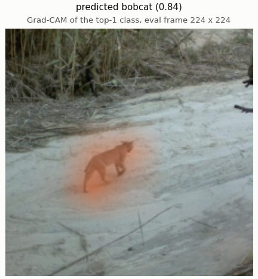
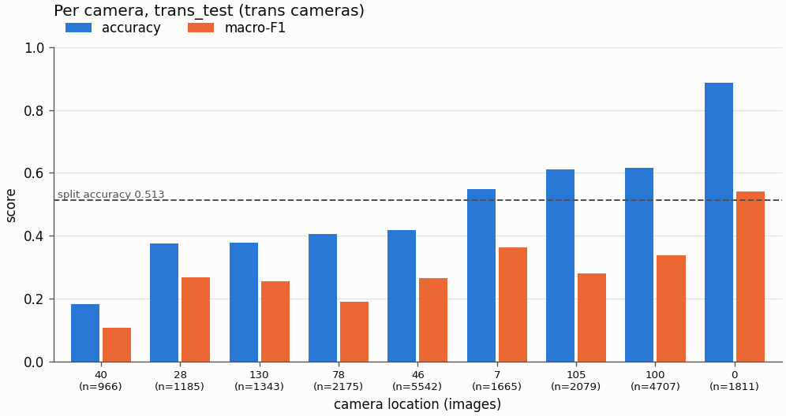
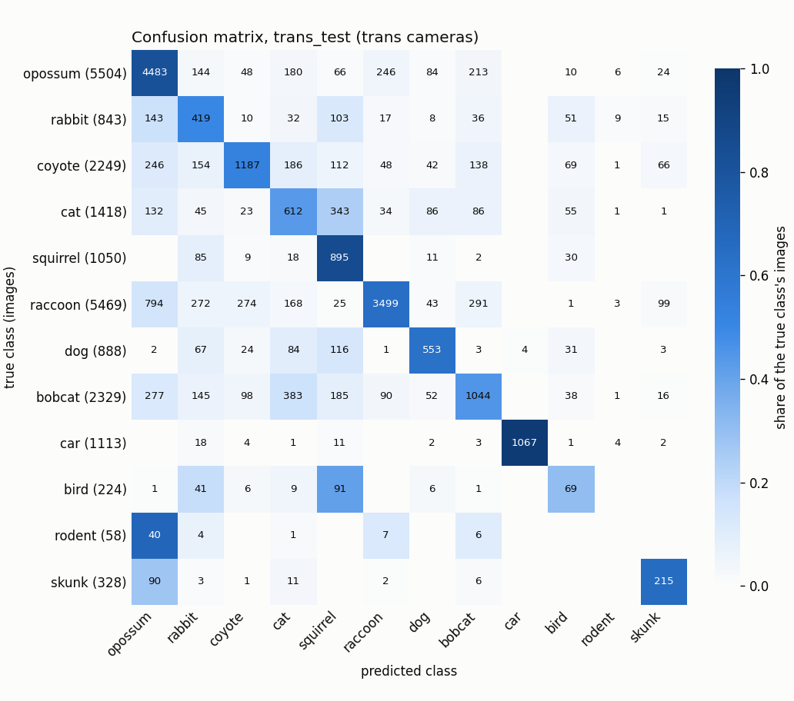
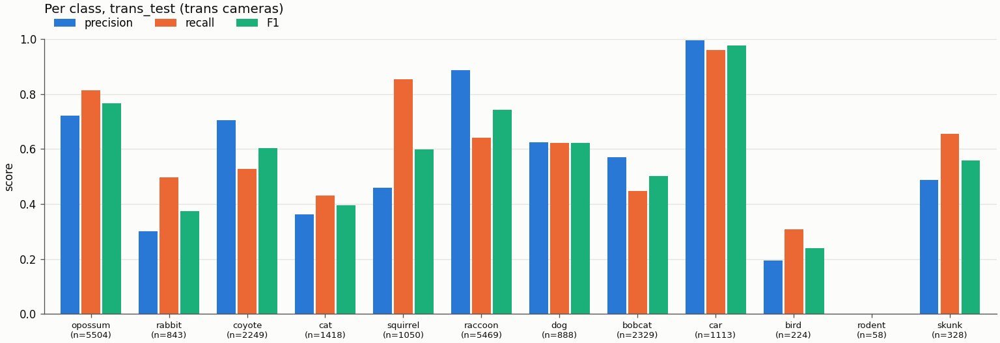
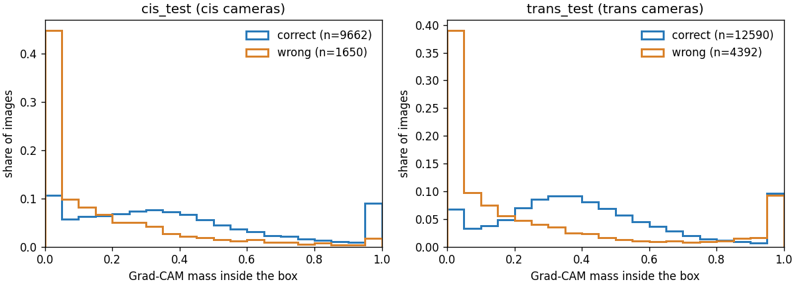
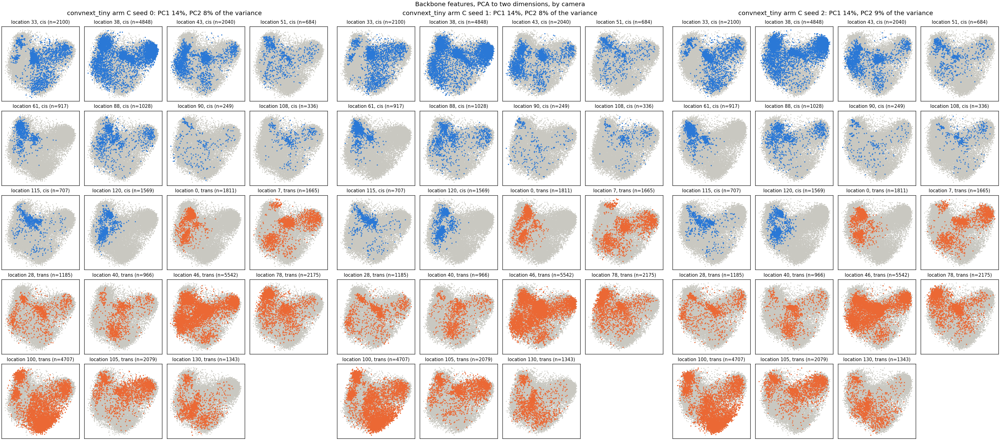
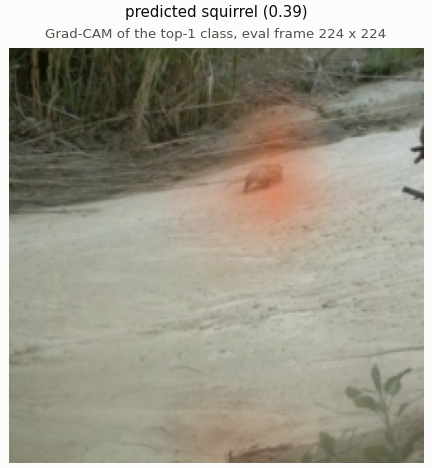

# Who Goes There

**A camera-trap species classifier that has to work on cameras it has never seen.**
Try it live: **<https://huggingface.co/spaces/Codx999/who-goes-there>**

Camera traps take photos faster than people can label them. This project trains a PyTorch model
that looks at one camera-trap photo and names the animal in it: one of 11 animals, or a car. The
hard part is that every camera has its own fixed background, so a model can learn the scenery
instead of the animal and then fail on a camera it has never seen. The project measures that gap
on the Caltech Camera Traps dataset and then shrinks it.

Built as the capstone for the bootcamp *AI and Machine Learning: Code, Train, & Deploy*
(presentation 2026-11-04).

## Results at a glance

Test accuracy, the share of photos named correctly, as the mean of 3 training runs. "Familiar
cameras" are the 10 cameras seen in training, photographed at other times (14,478 photos); "new
cameras" are 9 cameras never seen in training (21,473 photos).

| model | familiar cameras | new cameras | gap |
| --- | --- | --- | --- |
| Small CNN, trained from scratch (1 run) | 50% | 31% | 19 points |
| ResNet-18, pretrained (the baseline) | 67% | 51% | 16 points |
| **ConvNeXt-Tiny + copy-paste (the final model)** | **76%** | **66%** | **10 points** |

- **The gap is real:** every model does worse on cameras it has never seen, the same kind of gap
  Beery et al. (2018) reported on this dataset.
- **It got smaller:** a stronger pretrained model plus *copy-paste* augmentation (pasting animals
  onto empty photos from other cameras, so animal and background stop going together) raised
  new-camera accuracy from 51% to 66% and cut the gap from 16 to 10 points.
- **What is still hard:** rare species on new cameras (bird, rodent, skunk), and the model still
  uses the background more than it should.

| | |
| --- | --- |
|  |  |
| A bobcat from a new camera: the first model called it a cat; the final model says bobcat (84%), with its attention on the animal. | Accuracy per new camera for the baseline ResNet-18 (one run): some cameras are much harder than others. |

## How it works

1. **Data:** Caltech Camera Traps (CCT20), 20 cameras in the American Southwest. It is not in
   `torchvision.datasets`, so it is loaded with a custom PyTorch `Dataset`. Photos are split by
   camera, and by burst within the training cameras, so no near-duplicate frame leaks between
   training and validation.
2. **Pipeline:** photos cropped to 224 × 224, augmentation on training photos only (crop, flip, colour,
   greyscale, and copy-paste for the final model), ImageNet normalisation, a `DataLoader` with
   batches of 64.
3. **Model:** an ImageNet-pretrained body (ResNet-18 for the baseline, ConvNeXt-Tiny for the final
   model) with a new 12-class head; cross-entropy loss; AdamW with a slow rate for the body and a
   fast one for the head; at most 10 epochs with a cosine schedule, keeping the best epoch on
   validation macro-F1.
4. **Choosing fairly:** each idea was one change from the same baseline, judged on validation and
   on one held-out new camera over 3 runs; the test sets were kept for the end.
5. **Training:** on a free Kaggle T4 GPU. **Deployment:** a Gradio app on Hugging Face Spaces,
   running on a CPU, about 0.1 s per photo.

## Try it

**Online:** open the [Space](https://huggingface.co/spaces/Codx999/who-goes-there), click one of
the example photos (or upload your own camera-trap photo) and press Classify. You get the top class
with its confidence, two runners-up, the inference time, and an optional Grad-CAM heat map of
where the model looked.

**Locally** (Python 3.12 and [uv](https://docs.astral.sh/uv/); the weights are not in this repo,
so pass a checkpoint trained with `trailcam.train`):

```bash
uv run python -m trailcam.demo.app --checkpoint <run>.pt --config-name p3_convnext_cp
```

Without a checkpoint, `--check` builds the interface with random weights and exits:

```bash
uv run python -m trailcam.demo.app --check
```

## What's in the repo

| path | what it holds |
| --- | --- |
| `trailcam/data/` | the custom `Dataset`, the camera-and-burst split, transforms, box-guided crops and copy-paste, `DataLoader`s |
| `trailcam/model/` | the small CNN and the pretrained backbones (ResNet-18, ConvNeXt-Tiny) |
| `trailcam/train/` | the training loop, config and run ledger |
| `trailcam/evaluate/` | metrics, test scoring, slices, hand-written Grad-CAM, attention and figures |
| `trailcam/demo/` | the Gradio app, the timed prediction, and a folder sorter |
| `notebooks/` | the Kaggle notebooks for training, evaluation and test scoring |
| `space/` | the Hugging Face Space (`app.py`, `requirements.txt`) |
| `scripts/` | checks, the data guard, Kaggle cache tools, the Space upload |
| `tests/` | the test suite, run by `scripts/check.sh` and CI |
| `config.yaml` | every training setting, one named config per model |

**Guide to `docs/`.** For results: the run ledgers ([`ledger.md`](docs/ledger.md),
[`ledger-phase2.md`](docs/ledger-phase2.md), [`ledger-phase3.md`](docs/ledger-phase3.md)), the two
test scorings ([`test-ledger.md`](docs/test-ledger.md),
[`test-ledger-phase3.md`](docs/test-ledger-phase3.md)), the dataset facts
([`data-card.md`](docs/data-card.md)) and the figures ([`docs/figures/`](docs/figures/)). The
other files in `docs/` are the project's working notes.

## Detailed results

The sections below use the project's working terms: **cis_test** is the familiar-camera test set,
**trans_test** the new-camera test set and **trans_val** the one new camera held out for choosing
(Beery et al.'s "cis" and "trans"). **Phase 1** trained the small CNN and two ResNet-18 arms
(**arm A** the baseline, **arm B** with box-guided crops); **phase 2** tried five changes and kept
none; **phase 3** kept ConvNeXt-Tiny with copy-paste.


The test sets have been used twice. Each use is reported in its own section, and neither replaces
the other:

- **Phase 1** (the next three subsections): the small CNN and both ResNet-18 arms, scored once
  after every phase-1 run had finished training.
- **Phase 3** ([below](#phase-3-convnext-tiny-with-copy-paste-the-second-test-scoring)): one
  recipe chosen on val and trans_val, scored after phase 1's test scores had been seen.

In phase 1 the two test sets were scored **once**, at the end, after every reported run had
finished training: approved by codx999, scored at 20261018T193117Z (UTC, 2026-10-18). Every choice
before that was made on val. cis_test is 14,478 images from the cameras seen in training, at other
times; trans_test is 21,473 images from 9 cameras never seen. No leakage alarm fired. The rows
are in [`docs/test-ledger.md`](docs/test-ledger.md); every seed is in
[`docs/figures/headline_test.md`](docs/figures/headline_test.md); the full write-up is
[`docs/plan.md`](docs/plan.md) section 7.

### Headline: seen cameras vs unseen cameras (phase 1)

Accuracy and macro-F1 (over the classes present), 12 classes. The gap is cis minus trans.

| model | cis_test accuracy | cis_test macro-F1 | trans_test accuracy | trans_test macro-F1 | accuracy gap | macro-F1 gap |
| --- | --- | --- | --- | --- | --- | --- |
| small CNN, seed 0 | 0.5026 | 0.4504 | 0.3140 | 0.2041 | 0.1886 | 0.2463 |
| ResNet-18 arm A, mean of 3 seeds | 0.6708 | 0.6216 | 0.5137 | 0.4127 | 0.1571 | 0.2089 |
| ResNet-18 arm B, mean of 3 seeds | 0.6808 | 0.6361 | 0.5387 | 0.4309 | 0.1422 | 0.2051 |

Every model loses 14 to 19 points of accuracy on cameras it has never seen. The pretrained
ResNet-18 arms beat the small CNN by about 20 points of trans_test accuracy.

### The experiment: boxes at training time only

Arm A and arm B are the same ResNet-18 with the same seeds and settings; they differ only in the
training crop. For a photo with a box, arm B half the time picks a random crop that holds the
animal's whole bounding box. At test time and in the demo both see the whole photo, with no box.

**Arm B beat arm A on trans_test on every one of the 3 seeds, by +2.5 points of accuracy and +1.8
points of macro-F1 on average (0.5387 against 0.5137, and 0.4309 against 0.4127): a small gain,
but a consistent one. It barely changed where the model looks: Grad-CAM attention inside the
animal's box rose by only about 0.002, and with the animal blanked out both arms still score
0.22 to 0.29 accuracy (chance is 0.083), so a large reliance on the background remains in both
arms.**

| seed | arm A trans_test accuracy | arm B trans_test accuracy | arm A trans_test macro-F1 | arm B trans_test macro-F1 |
| --- | --- | --- | --- | --- |
| 0 | 0.5131 | 0.5435 | 0.4071 | 0.4363 |
| 1 | 0.5216 | 0.5326 | 0.4169 | 0.4290 |
| 2 | 0.5065 | 0.5399 | 0.4141 | 0.4275 |

The attention score is the share of the Grad-CAM map inside the box; on trans_test an even map
scores 0.137, arm A scores 0.230 to 0.232 and arm B 0.232 to 0.234. The animal-removed test
blanks every box; accuracy falls from between 0.57 and 0.61 to between 0.22 and 0.29.

Experiment tables, mean of 3 seeds, scored on the images whose box lies inside the centre crop
(cis_test 11,312, trans_test 16,982; an even map's attention score is 0.127 on cis_test and 0.137
on trans_test):

| arm | attention-in-box, cis_test | attention-in-box, trans_test | trans_test accuracy | trans_test accuracy, box blanked | cis_test accuracy | cis_test accuracy, box blanked |
| --- | --- | --- | --- | --- | --- | --- |
| arm A | 0.2119 | 0.2315 | 0.5754 | 0.2470 | 0.7455 | 0.3445 |
| arm B | 0.2173 | 0.2331 | 0.6039 | 0.2613 | 0.7557 | 0.3406 |

Slice tables on trans_test, seed 0 (every seed is in
[`slices_test.md`](docs/figures/slices_test.md)); rare species are bird, rodent and skunk, under
4% of the training images:

| model | accuracy, day | accuracy, night | accuracy, common species | accuracy, rare species |
| --- | --- | --- | --- | --- |
| small CNN | 0.2961 | 0.3210 | 0.3226 | 0.0180 |
| ResNet-18 arm A | 0.5315 | 0.5058 | 0.5171 | 0.3754 |
| ResNet-18 arm B | 0.5618 | 0.5362 | 0.5504 | 0.3066 |

### Figures (phase 1)

Seed 0 on trans_test, the unseen cameras, unless noted; more in [`docs/figures/`](docs/figures/).

| | |
| --- | --- |
|  |  |
| Confusion matrix, arm B. | Accuracy and macro-F1 per unseen camera, arm B: some cameras are much harder than others. |
|  |  |
| Share of the Grad-CAM map inside the box, arm B, correct vs wrong predictions, on cis_test and trans_test. | Backbone features of the test photos projected to two dimensions, one panel per camera, both arms and all 3 seeds. |

Data: Caltech Camera Traps (CCT20), Beery et al. 2018, CDLA-Permissive 1.0 (see
[Dataset](#dataset)).

### Phase 3: ConvNeXt-Tiny with copy-paste, the second test scoring

**Disclosure.** This is the second time the test sets were used. They were scored for one recipe,
`p3_convnext_cp`. That recipe was chosen on val and trans_val only and fixed before the scoring,
but phase 1's test scores had already been seen (2026-10-18), and they may have shaped what
phases 2 and 3 tried. So these numbers are reported beside phase 1's, never in their place.
The rule is [`docs/phase3-plan.md`](docs/phase3-plan.md) section 7.

The recipe is ConvNeXt-Tiny (ImageNet-1k pretrained, the same pretraining as the ResNet-18) with
copy-paste (phase 2's arm C): during training, for half of the photos with a box, the box
region is pasted onto an empty frame from a training camera, night onto night and day onto day.
Everything else is phase 1's recipe, and at test time it sees the whole photo, as before. It ran
with 3 seeds, scored once each: approved by codx999, scored at 20261020T213420Z (UTC,
2026-10-20), on the same cis_test (14,478 images) and trans_test (21,473 images, 9 unseen
cameras). No leakage alarm fired. The rows are in
[`docs/test-ledger-phase3.md`](docs/test-ledger-phase3.md), and every seed is in
[`docs/figures/p3_headline_test.md`](docs/figures/p3_headline_test.md).

| model | cis_test accuracy | cis_test macro-F1 | trans_test accuracy | trans_test macro-F1 | accuracy gap | macro-F1 gap |
| --- | --- | --- | --- | --- | --- | --- |
| phase 1: ResNet-18 arm A, mean of 3 seeds | 0.6708 | 0.6216 | 0.5137 | 0.4127 | 0.1571 | 0.2089 |
| phase 1: ResNet-18 arm B, mean of 3 seeds | 0.6808 | 0.6361 | 0.5387 | 0.4309 | 0.1422 | 0.2051 |
| phase 3: ConvNeXt-Tiny + copy-paste, seed 0 | 0.7579 | 0.7260 | 0.6662 | 0.5465 | 0.0917 | 0.1794 |
| phase 3: ConvNeXt-Tiny + copy-paste, seed 1 | 0.7490 | 0.7171 | 0.6592 | 0.5319 | 0.0898 | 0.1851 |
| phase 3: ConvNeXt-Tiny + copy-paste, seed 2 | 0.7627 | 0.7292 | 0.6540 | 0.5315 | 0.1087 | 0.1977 |
| phase 3: ConvNeXt-Tiny + copy-paste, mean of 3 seeds | 0.7565 | 0.7241 | 0.6598 | 0.5367 | 0.0967 | 0.1874 |

**Against arm A**, the mean of 3 seeds:

- cis_test: accuracy +0.0857, macro-F1 +0.1025.
- trans_test: accuracy +0.1461, macro-F1 +0.1240.
- On trans_test, every phase-3 seed beats every phase-1 checkpoint. Its macro-F1 is up +0.14,
  +0.12 and +0.12 against arm A's seeds and +0.11, +0.10 and +0.10 against arm B's.

**Against arm B**, the mean of 3 seeds: trans_test accuracy +0.1211, macro-F1 +0.1058.

**What it means.**

- **The accuracy gap shrank by more than a third: 0.157 to 0.097.**
- **The macro-F1 gap barely moved: 0.209 to 0.187.** The model got better on the familiar cameras
  too.
- **Rare species on new cameras are still the hard part.** On trans_test, macro-F1 over the rare
  species (bird, rodent, skunk) is 0.43 against 0.63 for the common ones (mean of 3 seeds). On
  cis_test the rare species score 0.78. Rodent: 0 of 58 right on trans_test, on every seed.
- **This time trans_val predicted the gain well.** The trans_val macro-F1 gain was +0.10 against
  arm A; on trans_test it is +0.12.

**Two changes at once.** The new backbone and copy-paste changed together, so the test result
cannot say how much each one contributed. ConvNeXt-Tiny alone (`p3_convnext`) also passed phase
3's keep rule on val and trans_val, but only the finalist was scored on test. On trans_val alone,
the backbone gave about +0.05 macro-F1 and copy-paste about +0.06 more on top of it. That is one
camera's split, not a test result.

**Where it looks.** The table below covers the images whose box lies inside the centre crop, mean
of 3 seeds:

| model | attention-in-box, cis_test | attention-in-box, trans_test | trans_test accuracy | trans_test accuracy, box blanked | cis_test accuracy | cis_test accuracy, box blanked |
| --- | --- | --- | --- | --- | --- | --- |
| phase 1: ResNet-18 arm B | 0.2173 | 0.2331 | 0.6039 | 0.2613 | 0.7557 | 0.3406 |
| phase 3: ConvNeXt-Tiny + copy-paste | 0.3547 | 0.3794 | 0.7485 | 0.3510 | 0.8504 | 0.4435 |

- **More of the Grad-CAM heat lands in the box:** 0.38 on trans_test, where an even map scores
  0.137. The maps come from a different network's last stage, so set the two rows side by side
  as a rough comparison only.
- **The background still carries a large share.** With the box blanked, trans_test accuracy
  falls to 0.35. That is 47% of the unblanked score, against 43% for arm B.

Slice table on trans_test, seed 0, the same seed as phase 1's slice table above. Every seed is in
[`p3_slices_test.md`](docs/figures/p3_slices_test.md).

| model | accuracy, day | accuracy, night | accuracy, common species | accuracy, rare species |
| --- | --- | --- | --- | --- |
| phase 1: ResNet-18 arm B | 0.5618 | 0.5362 | 0.5504 | 0.3066 |
| phase 3: ConvNeXt-Tiny + copy-paste | 0.6563 | 0.6701 | 0.6718 | 0.4738 |

The day/night mix still does not explain the gap. Re-weighting trans_test to the cis night share
changes it by under 0.01.

**The Space's model.** Phase 3's Space seed was chosen on val, before the scoring: seed 2. It
scores 0.6540 accuracy and 0.5315 macro-F1 on trans_test; the live arm B seed 2 scores 0.5399 and
0.4275. Switching the Space to seed 2 is item 13.15, still pending; until it lands, the Space
serves arm B seed 2 (see [Demo](#demo)).

Phase-3 figures, seed 2 (the Space's next model), on trans_test unless noted:

| | |
| --- | --- |
|  |  |
| Confusion matrix. | Precision, recall and F1 per class: rodent gets no correct prediction; bird is next weakest. |
|  |  |
| Share of the Grad-CAM map inside the box, correct vs wrong, cis_test and trans_test. | ConvNeXt-Tiny features of the test photos, one panel per camera, all 3 seeds: still grouped by camera. |
|  |  |
| The bobcat that ResNet-18 arm B called cat (`gradcam_overlay_01.png`) is now bobcat (0.84), with the heat on the animal. | The opossum arm B called coyote with the heat on the background (`gradcam_overlay_08.png`) is now squirrel (0.39): still wrong, but the heat has moved onto the animal. |

Data: Caltech Camera Traps (CCT20), Beery et al. 2018, CDLA-Permissive 1.0 (see
[Dataset](#dataset)).

### Honest notes

- **trans_val pointed the other way in phase 1.** On trans_val, the unseen-camera val split,
  arm A led arm B (accuracy 0.3781 against 0.3338, mean of 3 seeds). trans_val is one camera
  (1,603 images, 734 of them bobcat), so its spread is mostly that camera's bobcat recall. It was
  reported, never used to choose anything; trans_test's 9 cameras overturned it. In phase 3,
  where it was used to choose, it predicted the test gain well. One camera is right sometimes,
  not always.
- **cis_test sits far below val** (accuracy 0.67 against 0.87, the same cameras). Val was drawn
  from the same weeks as training, cis_test from other times, so val is optimistic about time
  shift as well as location shift. Phase 3 shows the same pattern: val macro-F1 0.86, cis_test
  0.72. No leakage alarm fired.
- **The test sets were used twice.** Phase 1 scored all 7 of its checkpoints once, together,
  approved by codx999 on 2026-10-18. Phase 3 scored its one recipe's 3 checkpoints once, approved
  by codx999 on 2026-10-20. No recipe, seed or Space model was chosen on a test score. But phases 2
  and 3 were designed after phase 1's test scores had been seen. Phase 2 grounds copy-paste in
  val's animal-removed test, but the test scores may have shaped what was tried. So the phase-3
  numbers are not as clean an estimate of new cameras as phase 1's were.
- The day/night mix does not explain the gap in either phase: re-weighting trans_test to the cis
  night share changes it by about 0.01 or less ([`slices_test.md`](docs/figures/slices_test.md),
  [`p3_slices_test.md`](docs/figures/p3_slices_test.md)).

### Future work

- **Phase 2** tried five changes on val and trans_val, and none was kept
  ([`docs/phase2-plan.md`](docs/phase2-plan.md) section 12).
- **Phase 3** is complete: one recipe kept and scored on test, above
  ([`docs/phase3-plan.md`](docs/phase3-plan.md) section 13).
- **Beyond this project:**
  - train for more than 10 epochs, since two ConvNeXt runs peaked at the last one;
  - use new unseen cameras to separate the backbone from copy-paste, since the test sets have
    now been used twice;
  - detect, then classify (MegaDetector);
  - a backbone pretrained on species images (BioCLIP), after its pretraining data is checked
    for CCT photos.

### The live model

The Space serves phase 3's finalist, ConvNeXt-Tiny with copy-paste training (`p3_convnext_cp`)
seed 2, chosen on val, since 2026-10-21; on the Space's CPU a click takes about half a second,
Grad-CAM included. Phase 1's ResNet-18 arm B seed 2, which it served before, is the rollback.

## Dataset

[Caltech Camera Traps](https://lila.science/datasets/caltech-camera-traps), CCT20 benchmark
subset, from LILA BC. About 58k images from 20 camera locations in the American Southwest, with
the official location-based train / cis test / trans test split.

The images are **not** in this repo and never will be: `scripts/guard_data.py`, git hooks and CI
refuse them. Training downloads them from LILA inside a Kaggle notebook. Counts, classes, the
split and the demo photos' sources: [`docs/data-card.md`](docs/data-card.md).

License: [CDLA-Permissive 1.0](https://cdla.dev/permissive-1-0/). Please cite:

> Sara Beery, Grant Van Horn, Pietro Perona. "Recognition in Terra Incognita."
> Proceedings of the European Conference on Computer Vision (ECCV), 2018.
> https://arxiv.org/abs/1807.04975

## Development

Python 3.12 managed by [uv](https://docs.astral.sh/uv/). One script runs everything CI runs:

```bash
bash scripts/check.sh
```

Enable the data-guard hooks once per clone:

```bash
git config core.hooksPath .githooks
```

## References and credits

The problem, the dataset split and every improvement tried here come from published work or
standard practice; none of it is claimed as original.

**Dataset**

- Sara Beery, Grant Van Horn, Pietro Perona. "Recognition in Terra Incognita." ECCV 2018.
  <https://arxiv.org/abs/1807.04975>. The CCT20 split, the familiar vs new camera gap this project
  reproduces, and box-guided crops.
- Caltech Camera Traps on LILA BC: <https://lila.science/datasets/caltech-camera-traps>, licence
  [CDLA-Permissive 1.0](https://cdla.dev/permissive-1-0/). The photos in `assets/` and in the
  figures are from this dataset.

**Methods used**

- Kaiming He, Xiangyu Zhang, Shaoqing Ren, Jian Sun. "Deep Residual Learning for Image
  Recognition." CVPR 2016. <https://arxiv.org/abs/1512.03385> (ResNet-18, the baseline).
- Zhuang Liu, Hanzi Mao, Chao-Yuan Wu, Christoph Feichtenhofer, Trevor Darrell, Saining Xie. "A
  ConvNet for the 2020s." CVPR 2022. <https://arxiv.org/abs/2201.03545> (ConvNeXt-Tiny; weights
  `convnext_tiny.fb_in1k` from timm).
- Jia Deng et al. "ImageNet: A Large-Scale Hierarchical Image Database." CVPR 2009 (the
  pretraining data of both backbones).
- Ilya Loshchilov, Frank Hutter. "Decoupled Weight Decay Regularization." ICLR 2019.
  <https://arxiv.org/abs/1711.05101> (AdamW); and "SGDR: Stochastic Gradient Descent with Warm
  Restarts." ICLR 2017. <https://arxiv.org/abs/1608.03983> (cosine schedule).
- Irena Gao, Shiori Sagawa, Pang Wei Koh, Tatsunori Hashimoto, Percy Liang. "Out-of-Domain
  Robustness via Targeted Augmentations." ICML 2023, PMLR 202:10800-10834 (targeted augmentation
  for camera traps).
- Mesnage et al. "Copy-Paste Augmentation Improves Automatic Species Identification in Camera Trap
  Images." Ecology and Evolution 15(11):e72357, 2025.
  <https://pmc.ncbi.nlm.nih.gov/articles/PMC12588685/> (copy-paste for camera traps).
- Ramprasaath R. Selvaraju et al. "Grad-CAM: Visual Explanations from Deep Networks via
  Gradient-based Localization." ICCV 2017. <https://arxiv.org/abs/1610.02391> (the heat maps;
  implemented by hand in `trailcam/evaluate/gradcam.py`).

**Background**

- Robert Geirhos et al. "Shortcut Learning in Deep Neural Networks." Nature Machine Intelligence,
  2020. <https://arxiv.org/abs/2004.07780>.
- Pang Wei Koh et al. "WILDS: A Benchmark of in-the-Wild Distribution Shifts." ICML 2021.
  <https://arxiv.org/abs/2012.07421>.
- Mohammad Sadegh Norouzzadeh et al. "Automatically identifying, counting, and describing wild
  animals in camera-trap images with deep learning." PNAS, 2018.
  <https://doi.org/10.1073/pnas.1719367115>.
- Sara Beery, Dan Morris, Siyu Yang. "Efficient Pipeline for Camera Trap Image Review" (the
  MegaDetector). 2019. <https://arxiv.org/abs/1907.06772>.
- Stefan Schneider, Saul Greenberg, Graham W. Taylor, Stefan C. Kremer. "Three critical factors
  affecting automated image species recognition performance for camera traps." Ecology and
  Evolution, 2020. <https://doi.org/10.1002/ece3.6147>.
- Chuan Guo, Geoff Pleiss, Yu Sun, Kilian Q. Weinberger. "On Calibration of Modern Neural
  Networks." ICML 2017. <https://arxiv.org/abs/1706.04599>.
- Dussert, Chamaillé-Jammes, Dray, Miele. "Being confident in
  confidence scores: calibration in deep learning models for camera trap image sequences." Remote
  Sensing in Ecology and Conservation, 2024. <https://doi.org/10.1002/rse2.412>.
- Samuel Stevens et al. "BioCLIP: A Vision Foundation Model for the Tree of Life." CVPR 2024.
  <https://arxiv.org/abs/2311.18803> (future work).

**Course and tools**

- The course *AI and Machine Learning: Code, Train, & Deploy*, built on Daniel Bourke's *Learn
  PyTorch for Deep Learning: Zero to Mastery* (<https://github.com/mrdbourke/pytorch-deep-learning>);
  chapters 04 (custom datasets), 06 (transfer learning) and 09 (deployment).
- [PyTorch and torchvision](https://pytorch.org/), [timm](https://github.com/huggingface/pytorch-image-models),
  [Gradio](https://www.gradio.app/), [Hugging Face Spaces](https://huggingface.co/spaces),
  [Kaggle](https://www.kaggle.com/) notebooks (free T4 GPU), [uv](https://docs.astral.sh/uv/).

## License

Code is MIT licensed (see `LICENSE`). The dataset has its own license, above.
