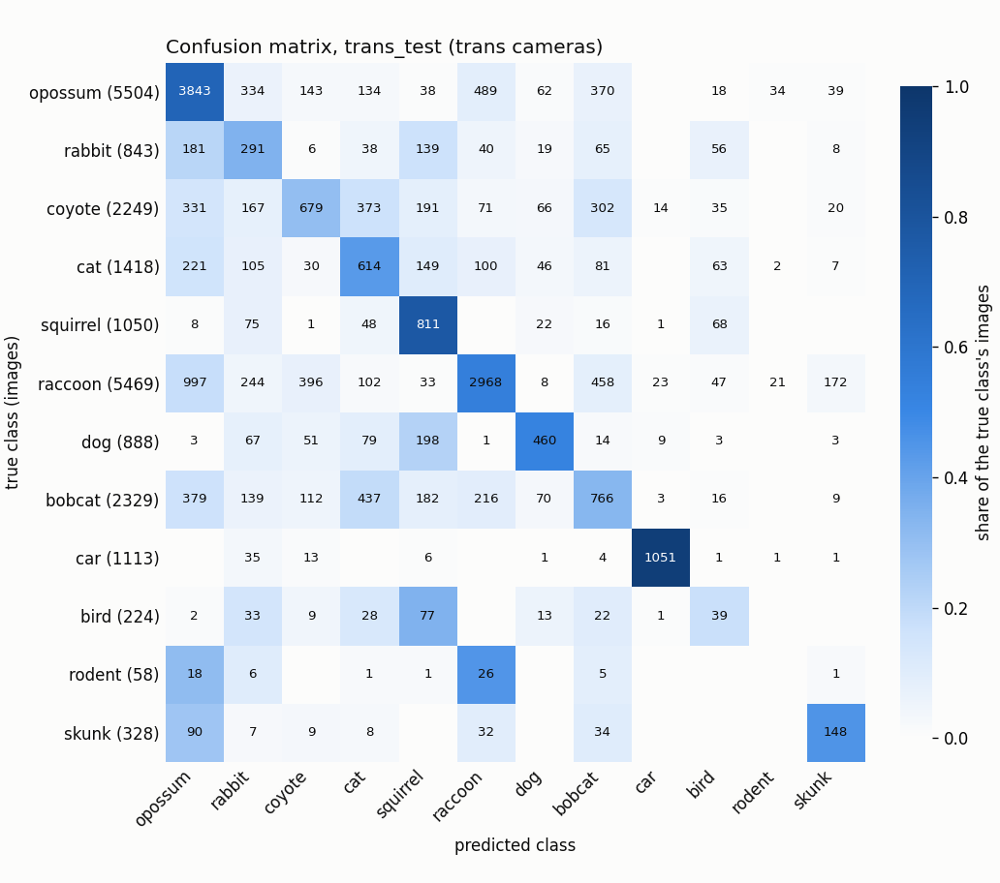
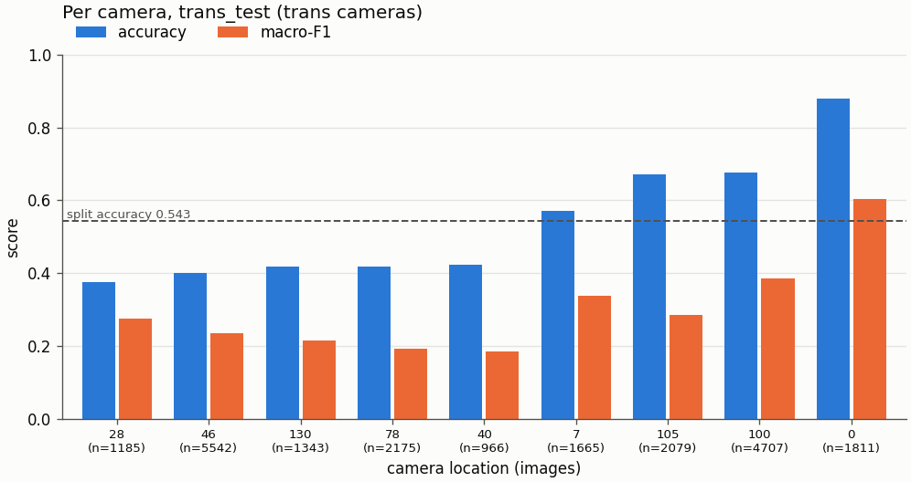
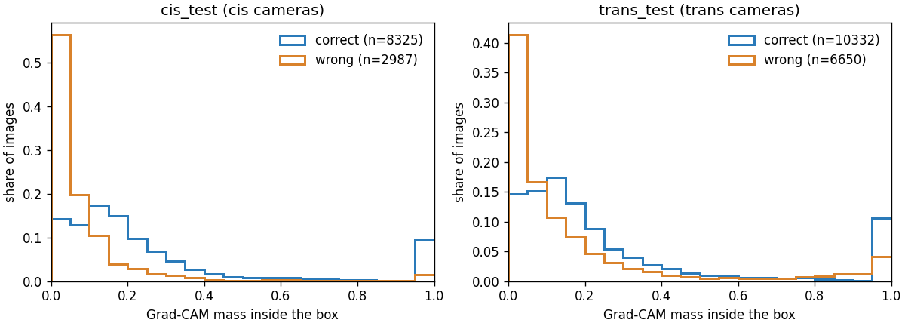
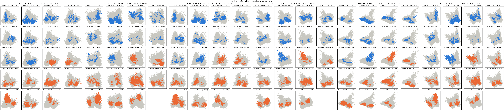

# Who Goes There

A PyTorch species classifier for camera-trap photos, tested on camera locations it never saw
during training. Bootcamp capstone; presentation 2026-11-04.

Given one camera-trap image, the model names the animal in it. The headline result compares
accuracy on **cis** test images (cameras also seen in training) with **trans** test images
(cameras never seen), which shows how much a model leans on a camera's fixed background instead
of the animal.

## Status

Phase 1 is complete: the small CNN and both ResNet-18 arms are trained, and the test sets were
scored once on 2026-10-18 (results below). Phase 2 is in progress. The design and every decision
are in [`docs/plan.md`](docs/plan.md); the work log is
[`docs/progress-log.md`](docs/progress-log.md).

## Results

The two test sets were scored **once**, at the end, after every reported run had finished
training: approved by codx999, scored at 20261018T193117Z (UTC, 2026-10-18). Every choice before
that was made on val. cis_test is 14,478 images from the cameras seen in training, at other
times; trans_test is 21,473 images from 9 cameras never seen. No leakage alarm fired. The rows
are in [`docs/test-ledger.md`](docs/test-ledger.md); every seed is in
[`docs/figures/headline_test.md`](docs/figures/headline_test.md); the full write-up is
[`docs/plan.md`](docs/plan.md) section 7.

### Headline: seen cameras vs unseen cameras

Accuracy and macro-F1 (over the classes present), 12 classes. The gap is cis minus trans.

| model | cis_test accuracy | cis_test macro-F1 | trans_test accuracy | trans_test macro-F1 | accuracy gap | macro-F1 gap |
| --- | --- | --- | --- | --- | --- | --- |
| small CNN, seed 0 | 0.5026 | 0.4504 | 0.3140 | 0.2041 | 0.1886 | 0.2463 |
| ResNet-18 arm A, mean of 3 seeds | 0.6708 | 0.6216 | 0.5137 | 0.4127 | 0.1571 | 0.2089 |
| ResNet-18 arm B, mean of 3 seeds | 0.6808 | 0.6361 | 0.5387 | 0.4309 | 0.1422 | 0.2051 |

Every model loses 14 to 19 points of accuracy on cameras it has never seen. The pretrained
ResNet-18 arms beat the small CNN by about 20 points of trans_test accuracy.

### The experiment: boxes at training time only

Arm A and arm B are the same ResNet-18 with the same seeds and settings; they differ only in the
training crop. For a photo with a box, arm B half the time picks a random crop that holds the
animal's whole bounding box. At test time and in the demo both see the whole photo, with no box.

**Arm B beat arm A on trans_test on every one of the 3 seeds, by +2.5 points of accuracy and +1.8
points of macro-F1 on average (0.5387 against 0.5137, and 0.4309 against 0.4127): a small gain,
but a consistent one. It barely changed where the model looks: Grad-CAM attention inside the
animal's box rose by only about 0.002, and with the animal blanked out both arms still score
0.22 to 0.29 accuracy (chance is 0.083), so a large reliance on the background remains in both
arms.**

| seed | arm A trans_test accuracy | arm B trans_test accuracy | arm A trans_test macro-F1 | arm B trans_test macro-F1 |
| --- | --- | --- | --- | --- |
| 0 | 0.5131 | 0.5435 | 0.4071 | 0.4363 |
| 1 | 0.5216 | 0.5326 | 0.4169 | 0.4290 |
| 2 | 0.5065 | 0.5399 | 0.4141 | 0.4275 |

The attention score is the share of the Grad-CAM map inside the box; on trans_test an even map
scores 0.137, arm A scores 0.230 to 0.232 and arm B 0.232 to 0.234. The animal-removed test
blanks every box; accuracy falls from between 0.57 and 0.61 to between 0.22 and 0.29.

Experiment tables, mean of 3 seeds, scored on the images whose box lies inside the centre crop
(cis_test 11,312, trans_test 16,982; an even map's attention score is 0.127 on cis_test and 0.137
on trans_test):

| arm | attention-in-box, cis_test | attention-in-box, trans_test | trans_test accuracy | trans_test accuracy, box blanked | cis_test accuracy | cis_test accuracy, box blanked |
| --- | --- | --- | --- | --- | --- | --- |
| arm A | 0.2119 | 0.2315 | 0.5754 | 0.2470 | 0.7455 | 0.3445 |
| arm B | 0.2173 | 0.2331 | 0.6039 | 0.2613 | 0.7557 | 0.3406 |

Slice tables on trans_test, seed 0 (every seed is in
[`slices_test.md`](docs/figures/slices_test.md)); rare species are bird, rodent and skunk, under
4% of the training images:

| model | accuracy, day | accuracy, night | accuracy, common species | accuracy, rare species |
| --- | --- | --- | --- | --- |
| small CNN | 0.2961 | 0.3210 | 0.3226 | 0.0180 |
| ResNet-18 arm A | 0.5315 | 0.5058 | 0.5171 | 0.3754 |
| ResNet-18 arm B | 0.5618 | 0.5362 | 0.5504 | 0.3066 |

### Figures

Seed 0 on trans_test, the unseen cameras, unless noted; more in [`docs/figures/`](docs/figures/).

| | |
| --- | --- |
|  |  |
| Confusion matrix, arm B. | Accuracy and macro-F1 per unseen camera, arm B: some cameras are much harder than others. |
|  |  |
| Share of the Grad-CAM map inside the box, arm B, correct vs wrong predictions, on cis_test and trans_test. | Backbone features of the test photos projected to two dimensions, one panel per camera, both arms and all 3 seeds. |

Data: Caltech Camera Traps (CCT20), Beery et al. 2018, CDLA-Permissive 1.0 (see
[Dataset](#dataset)).

### Honest notes

- **trans_val pointed the other way.** On trans_val, the unseen-camera val split, arm A led
  arm B (accuracy 0.3781 against 0.3338, mean of 3 seeds). trans_val is one camera (1,603
  images, 734 of them bobcat), so its spread is mostly that camera's bobcat recall. It was
  reported, never used to choose anything; trans_test's 9 cameras overturned it.
- **cis_test sits far below val** (accuracy 0.67 against 0.87, the same cameras). Val was drawn
  from the same weeks as training, cis_test from other times, so val is optimistic about time
  shift as well as location shift. No leakage alarm fired.
- **The test sets were scored once**, approved by codx999 on 2026-10-18, for all 7 checkpoints
  together. Nothing was chosen after seeing a test score; the Space's model (arm B seed 2) was
  chosen on val.
- The day/night mix does not explain the gap: re-weighting trans_test to the cis night share
  changes it by about 0.01 or less ([`slices_test.md`](docs/figures/slices_test.md)).

### What's next

Phase 2 tries to close more of the unseen-camera gap: see
[`docs/phase2-plan.md`](docs/phase2-plan.md). Its results are not in this README yet.

## Demo

Live demo on Hugging Face Spaces: **<https://huggingface.co/spaces/Codx999/who-goes-there>**. It serves ResNet-18
arm B seed 2: upload a camera-trap photo, get the top class with its confidence, the two
runners-up, the inference time and an optional Grad-CAM overlay.

Run it locally (the weights are never in this repo; pass a `train.py` checkpoint):

```bash
uv run python -m trailcam.demo.app --checkpoint <run>.pt --config-name resnet18_arm_b
```

Without a checkpoint, `--check` builds the interface with random weights and exits:

```bash
uv run python -m trailcam.demo.app --check
```

## Dataset

[Caltech Camera Traps](https://lila.science/datasets/caltech-camera-traps), CCT20 benchmark
subset, from LILA BC. About 58k images from 20 camera locations in the American Southwest, with
the official location-based train / cis test / trans test split.

The images are **not** in this repo and never will be: `scripts/guard_data.py`, git hooks and CI
refuse them. Training downloads them from LILA inside a Kaggle notebook. Counts, classes, the
split and the demo photos' sources: [`docs/data-card.md`](docs/data-card.md).

License: [CDLA-Permissive 1.0](https://cdla.dev/permissive-1-0/). Please cite:

> Sara Beery, Grant Van Horn, Pietro Perona. "Recognition in Terra Incognita."
> Proceedings of the European Conference on Computer Vision (ECCV), 2018.
> https://arxiv.org/abs/1807.04975

## Development

Python 3.12 managed by [uv](https://docs.astral.sh/uv/). One script runs everything CI runs:

```bash
bash scripts/check.sh
```

Enable the data-guard hooks once per clone:

```bash
git config core.hooksPath .githooks
```

## License

Code is MIT licensed (see `LICENSE`). The dataset has its own license, above.
